# 选股雷达 Stock Radar

基于 LLM + LangGraph 的 A 股智能分析 Agent。用自然语言提问即可完成选股、行情查询、技术分析、估值测算、新闻情绪分析、板块轮动等全链路分析。

> 当前版本：**v2.2「看得见，挖得动」** —— 研究过程第一次变成可读的产品：新增深度研报 Agent、K 线技术面八层几何标注、资金面与公司事件、持仓画像、信号评测 5 日口径。[查看更新详情](#v22-更新内容)

**产品实拍**（均为产品真实运行画面，v2.2 深度研报阅读页）：

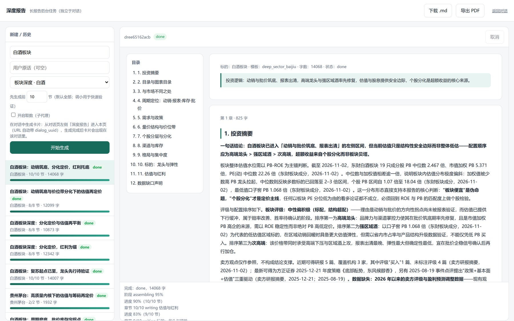

---

## ⚠️ 免责声明

**本项目仅供学习和研究使用，不构成任何投资建议。**

- 本项目输出的全部内容（包括但不限于分析报告、技术指标、选股结果、估值结论、板块判断）均由大语言模型自动生成，**可能存在事实错误、数据延迟、逻辑缺陷或完全错误的推断**。
- 本项目**不是**持牌投资咨询机构，开发者**不具备**证券投资咨询业务资格，输出内容不属于《证券投资顾问业务暂行规定》所指的投资建议。
- **请勿将本项目的任何输出作为买入、卖出或持有任何证券的唯一依据。** 据此操作，风险自负，盈亏自担。
- 数据来自第三方公开接口，可能存在延迟、缺失或错误，请以交易所及券商官方行情为准。
- 使用本项目产生的 API 调用费用、数据服务费用及其他成本由使用者自行承担。

完整条款见 [DISCLAIMER.md](DISCLAIMER.md)。继续使用本项目即视为你已阅读并同意上述条款。

---

## 功能特性

| 能力 | 说明 |
| --- | --- |
| 自然语言交互 | 中文提问即可驱动完整分析流程，无需记忆命令 |
| 6 种 Agent 模式 | ReAct / Plan & Solve / Unified Plan / PDOR / Scenario / Agent Group，按问题复杂度切换 |
| 11+ 数据源 | Sina、AKShare、BaoStock、eFinance、Tushare、PyTdx、腾讯、同花顺官方、yfinance、Finnhub、Longbridge，按优先级自动降级 |
| 20 个内置技能 | 综合个股分析、估值、资金流、板块轮动、龙虎榜、融资融券、基金查询、聚合统计、宏观数据、市场复盘、组合查询、策略研究、联网搜索、公司事件，及港股科技 / 黄金 / 铜 / 生猪 / 债券 / 红利主题环境 |
| 深度研报 Agent | 模板驱动骨架 → 并行取数 → 分节写作 → 确定性校验 + 语义审稿 → 自动返工，带阅读页、证据卡与数据缺口清单 |
| K 线技术面八层 | 回撤（斐波那契）/ 通道 / 扇形 / 趋势线 / 支撑阻力带 / 波段结构 / 回归通道 / 跳空缺口，均为算法生成的几何测量线，**不是交易信号** |
| 资金面与公司事件 | 融资融券余额分位 + 龙虎榜营业部席位；解禁 / 分红除权 / 预约披露 / 股东大会 / 业绩预告月历，及持仓自选未来 30 天事件条 |
| 持仓分析 | 账户历史快照（日历热力 + 构成流）、持仓构成三样式、相关矩阵、组合画像四象限 |
| 图片输入 | 看盘截图 / 公告截图直接进对话：先判类型，再按结构转述为文字 |
| 研究工作台 | 全局总览大屏、盯盘告警、短线情绪观测、研究台账、策略研发闭环、评估与对话评审、信号评测 |
| 三维预算控制 | Token / LLM 调用次数 / 时间，超限时中断并提示，防止成本失控 |
| 调用链追踪 | 完整 Agent 执行链路持久化到 SQLite，支持溯源回放 |
| 记忆系统 | FTS5 全文检索 + 向量检索 + RRF 混合召回，可选的 Cross-Encoder 精排 |
| 回测引擎 | 基于 Backtrader，支持策略回测与指标计算 |
| Web 工作台 | FastAPI + 前端面板，支持对话、配置、回测、决策仪表盘 |
| 通知推送 | 钉钉 / 飞书 / 企业微信 / Telegram / 邮件 / Webhook 等 12 种渠道 |

## 界面预览（能力面板）

对话与研报界面见上文 [v2.2 更新内容](#v22-更新内容)，这里是被各功能页用到的其余面板。

**更多能力面板**

| 回测引擎 | Skill 管理 |
| --- | --- |
| 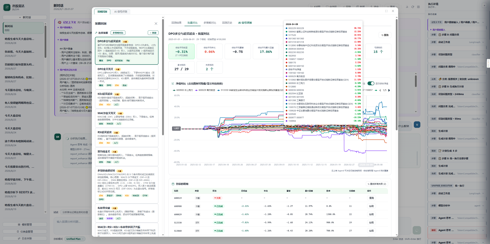 | 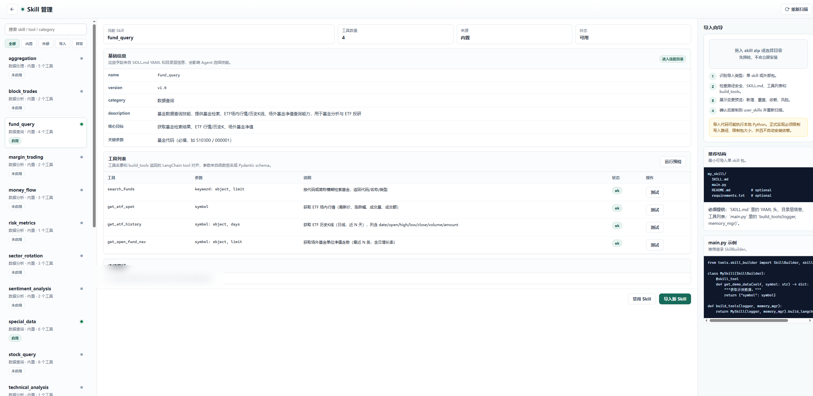 |

| 报告模板管理 | 工具在线测试 |
| --- | --- |
| 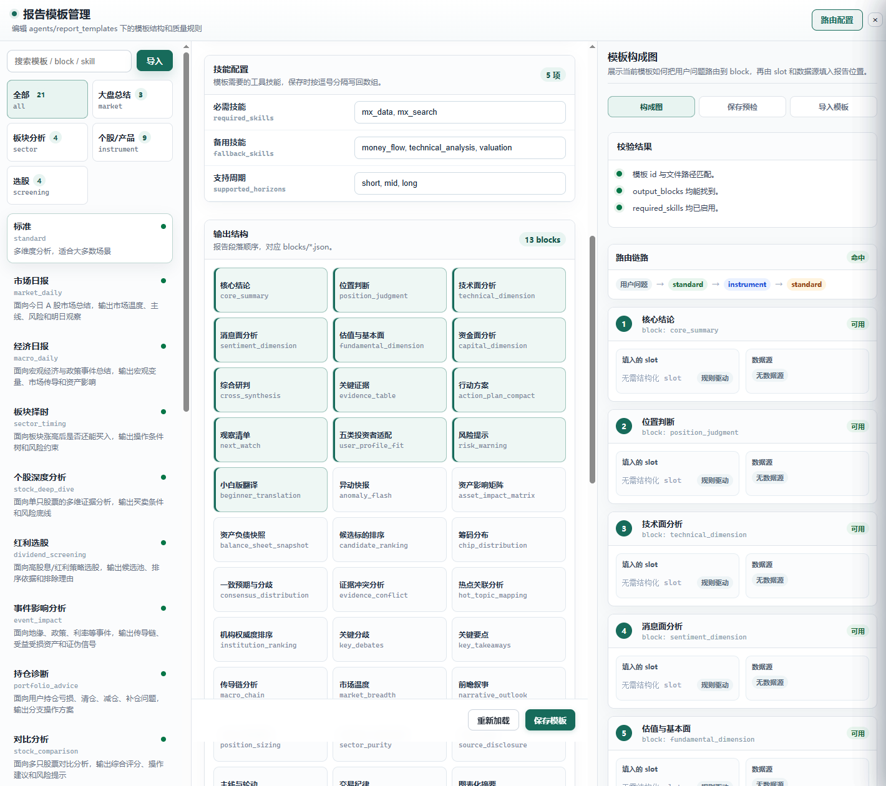 | 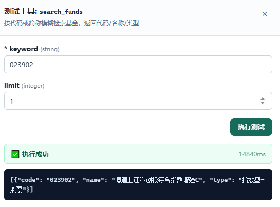 |

## v2.2 更新内容

**「看得见，挖得动」**——v2.1 让结论敢用，这一版让**过程看得见、数字挖得动**。

> 完整说明见 [RELEASE-NOTES-v2.2.md](RELEASE-NOTES-v2.2.md)（本次 443 次提交 / 848 个文件 / +16.3 万行）。

### 1. 深度研报 Agent（全新子系统）

模板驱动大纲 → 按能力**并行取数** → **串行分节写作** → 确定性校验 + 语义审稿 → 单节返工 → 渲染阅读页与对话卡片。

- 章节结构写在模板 JSON 里（内置 9 个深度报告模板），新增行业模板＝只加一个 JSON；
- **证据卡是唯一事实源**：正文里的数字必须能在证据卡中找到，卡片缺 `source` / `asof` 视为不可用；
- 报告密度有硬指标（8–10 节应 ≥10 张图），LLM 挑图不足时按优先级自动补足；
- 依赖第三方额度的能力（如机构一致预期）额度耗尽时如实 `no_data` 并写进缺口清单，**不编数**；
- 可导出 `.md` / PDF。

**阅读页**（左侧章节导航 + 证据与数据缺口写进正文）：


**工作台**（新建 / 历史 / 进度 / 模板选择，长报告后台任务独立于对话）：

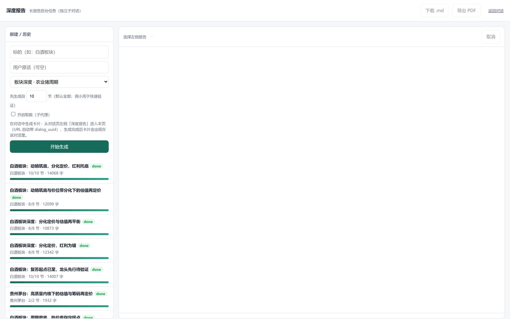

### 2. K 线：技术面八层几何标注

回撤（斐波那契）/ 通道 / 扇形 / 自动趋势线 / 支撑阻力带 / 波段结构 / 回归通道 / 跳空缺口，共 9 档（默认关）。

- 纯几何计算，与 K 线共用**同一个复权口径**，否则标注会整体浮在蜡烛外；
- 摆动点取真实 `high` / `low` 极值，腿被反向破位时重锚；
- 每个图层标明依据的摆动点与触碰次数，并统一后缀「**算法生成，非交易信号**」；
- 区间交互：1 月 / 2 月 / 3 月 / 半年 / 1 年 / 2 年、连续拉长缩短、自定义起止日期；一键导出白底 2 倍 PNG。

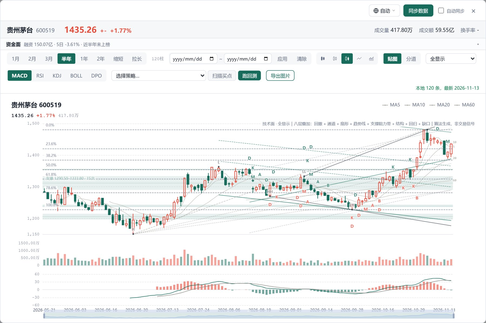

### 3. 资金面与公司事件

| 能力 | 说明 |
| --- | --- |
| 融资融券 | 本地日线级别的余额、环比、5 / 20 日变化、历史分位与风险档 |
| 龙虎榜席位 | 最近上榜日的营业部买卖净额（前 6 席） |
| 公司事件日历 | 解禁 / 分红除权 / 预约披露 / 股东大会 / 业绩预告五类，月历图层 + 持仓自选未来 30 天事件条 |

> 口径说明：**北向个股接口自 2024-08 起停更**，资金面因此改为融资融券口径。

### 4. 持仓分析 / 信号评测

- 持仓：每日账户快照 → 日历热力与构成流；持仓构成点阵 / 树图 / 横条三样式；相关矩阵与强相关对；画像四象限 + 平行坐标；
- 信号评测：口径统一为「信号触发后 5 个交易日」，按可执行时点入场（盘中收盘 / 次日开盘），配对按标的 FIFO；多周期洞察页、条件单、多方向按组提取。

### 5. 对话与配置

- **图片输入**：看盘截图粘贴进对话，先判类型（行情图 / 公告研报 / 表格 / 界面 / 照片）再按结构转述；90 秒硬超时；三层清理（删对话联动 / 每日巡检 / 手动脚本）；
- **配置面板只写不读密钥**：`GET /api/config` 对敏感项永不回显（连掩码都不给），只回 `configured`；留空表示不改；`.env` 落盘前做往返校验，读不回来就整体拒绝，一个字节不落盘；页脚提供 LLM / 搜索 / 数据源 / 记忆四项连通性检测。

### 6. 工程底座

- **前缀缓存对齐**：仪表盘复用报告 payload 前缀后命中率 20.1% → 67%；skill-router 复用主链前缀；
- **上下文瘦身**：精简输入（每 run 省约 5,800 token）、历史剥离图表标记（省约 31% 字符）、trace 载荷内容寻址压缩（月库 306MB → 26MB）；
- **全站卡顿真因修复**：`market_data.db` 未开 WAL，写事务持锁期间全站读被阻塞；
- 新增 8 个 API 路由模块（共 306 个端点）、数据库新增 14 张表（迁移器只加不删）。

### 7. 全局总览：台账与宏观同屏

左侧待办与提醒、中间研究台账（每张卡给总分 / 因子明细 / 告警）、右侧宏观指标看板（利率 / 汇率 / 通胀 / 商品），下面接活跃度热力与会话上下文档案 —— 16 个区块按 60 秒自适应刷新，每个数字都能点开看依据与数据截止日。

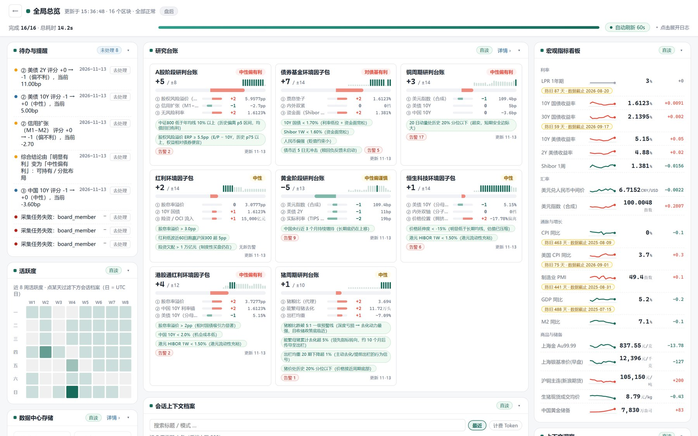

### 8. 修复 v2.1 的一个遗留缺陷：前端静态库

v2.1 公开版有 4 个前端文件引用了 `server/static/lib/` 下的第三方库（marked / mermaid / highlight.js / html-to-image），但仓库里没有这些文件 → markdown 渲染、代码高亮、mermaid 图、导出图片全部 404。

本版改为**脚本拉取、不入库**（合计约 3.5MB，mermaid 单个就 3.3MB）：首次运行执行 `python scripts/ops/fetch_static_libs.py`，按锁定版本 + sha256 校验下载，幂等可重跑。详见 [server/static/LIB-README.md](server/static/LIB-README.md)。

## v2.1 更新内容

**「可验证投研工作台」**——从"能回答问题"升级为"结论可验证、过程可回溯、策略可复盘"。

### 真实使用画面

**全局总览大屏**（新增）—— 16 个研判子包评分、全球指数、事件日志同屏（当前界面见上文「全局总览」）：

**短线情绪观测**（新增）—— 情绪周期、连板梯队、赚钱效应量化打分：

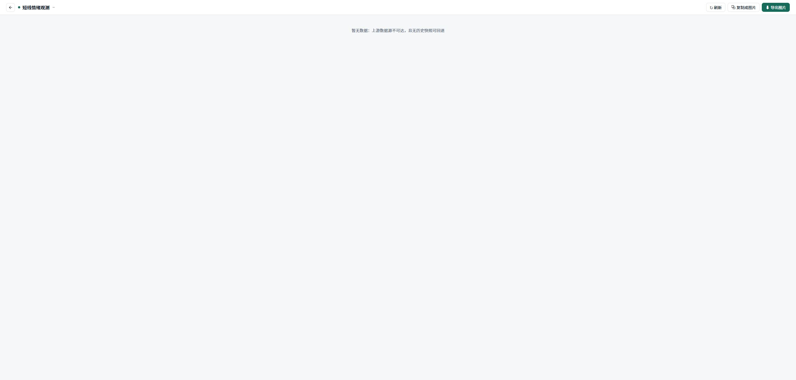

**研究台账**（新增）—— 多资产研判留痕，加仓 / 减仓信号逐条数据验证：

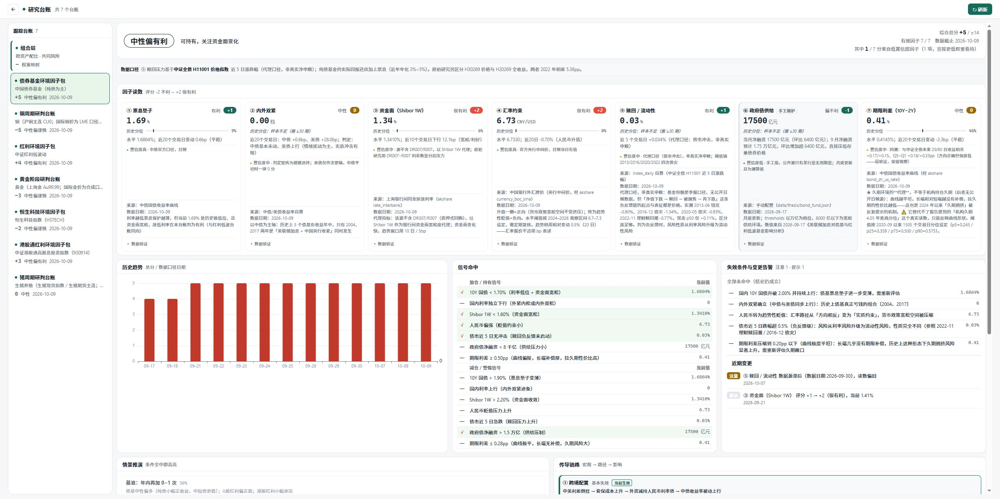

### 架构

- 新增 `eval` / `thesis` / `crowding` / `signal_eval` 四个顶层包，评测、研究台账、拥挤度观测、信号评估能力一并开源
- 报告模板 21 → 24，仪表盘 7 → 10，新增全局总览大屏

### 技能：12 → 19

| 变化 | 说明 |
| --- | --- |
| 新增技能 | 宏观数据、市场复盘、组合查询、综合个股分析、策略研究、联网搜索 |
| 新增主题环境 | 港股科技 / 黄金 / 铜 / 生猪 / 债券 / 红利 |
| 整合 | `stock_query` + `technical_analysis` + `risk_metrics` 合并为 `stock_analysis`，`sentiment_analysis` / `special_data` 并入能力映射 |

### 新增子系统

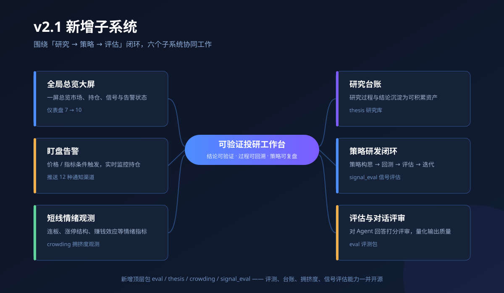

| 子系统 | 说明 |
| --- | --- |
| 全局总览大屏 | 一屏总览市场、持仓、信号与告警状态 |
| 盯盘告警 | 价格 / 指标条件触发，推送至 12 种通知渠道 |
| 短线情绪观测 | 连板、涨停结构、赚钱效应等短线情绪指标 |
| 研究台账 | 研究过程与结论沉淀，形成可积累的研究资产 |
| 策略研发闭环 | 策略构思 → 回测 → 评估 → 迭代的完整链路 |
| 评估与对话评审 | 对 Agent 回答打分评审，量化输出质量 |

### 交互升级

- **澄清反问**：问题模糊时主动澄清，而不是硬猜
- **任务停止**：长任务可随时中断
- **对话过程流**：think / 工具节点全程可回溯
- **技能渐进披露**：按需展开技能细节，界面更清爽
- **报告证据下钻**：结论可逐级下钻到数据与推理依据

### 工程质量

- 新增 203 个测试文件（全库 463 个），`unit` / `integration` / `e2e` 分层
- 同步脚本白名单补齐 4 个顶层包，并自动并入 git 忽略项，防止本地产物误发

> 顶部的产品速览动画为真实截图轮播，GitHub 页面内直接自动播放，无需下载。

## 快速开始

### 环境要求

- Python **3.11+**
- **TA-Lib** C 库（技术指标计算依赖，需单独安装）

### 安装

```bash
# 1. 克隆仓库
git clone https://github.com/wode98k233/stock_agent.git
cd stock_agent

# 2. 创建虚拟环境
python -m venv .venv
.venv\Scripts\activate          # Windows
# source .venv/bin/activate    # Linux / macOS

# 3. 安装依赖
pip install -r requirements.txt

# 4. 补齐前端静态库（Web UI 的 markdown / 代码高亮 / mermaid / 导出图片依赖，约 3.5MB）
python scripts/ops/fetch_static_libs.py
```

**TA-Lib 安装**（最容易卡住的一步）：

```bash
# Windows：下载对应 Python 版本的 .whl 后本地安装
#   https://github.com/cgohlke/talib-build/releases
pip install TA_Lib-0.4.xx-cp311-cp311-win_amd64.whl

# Ubuntu / Debian
sudo apt install libta-lib0-dev ta-lib && pip install TA-Lib

# macOS
brew install ta-lib && pip install TA-Lib
```

### 配置

```bash
cp .env.example .env
```

**最小可用配置**——只需填一个 LLM Key：

```env
OPENAI_API_KEY=sk-xxxxxx
OPENAI_API_BASE=https://api.deepseek.com/v1    # 以 DeepSeek 为例
OPENAI_MODEL_NAME=deepseek-chat
```

其余数据源（Tushare、同花顺等）全部可选，留空则自动禁用对应数据源，项目仍可正常运行。

> ⚠️ **公开版不含东方财富妙想（MX）子模块**：`.env.example` 里保留 `MX_APIKEY` 只为与上游配置对齐，**请勿配置**；相关能力会自动降级到同花顺 / AKShare 等通道。

> 完整配置项说明见 [.env.example](.env.example)，共 200+ 项，均已注释。

### 运行

```bash
# TUI 工作台（推荐）
python main.py

# 传统 REPL
python main.py --cli

# 一次性提问，执行完即退出
python main.py "分析一下贵州茅台的估值"

# Web 工作台
python -m server
# 浏览器打开 http://127.0.0.1:8000
```

## 使用示例

```
> 今日涨幅超过5%且市值大于100亿的股票有哪些
> 对比宁德时代和比亚迪的估值
> 半导体板块最近一周的资金流向
> 600519 的技术面怎么样
> 帮我看看我的自选股有没有风险
```

CLI 内以 `/` 开头执行命令：

| 命令 | 作用 |
| --- | --- |
| `/help` | 查看全部命令 |
| `/mode` | 切换 Agent 模式 |
| `/skills` | 查看已加载技能 |
| `/status` | 查看会话状态与预算消耗 |
| `/config` | 查看当前配置 |
| `/trace` | 调用链追踪与溯源 |
| `/watchlist` | 管理自选股 |
| `/templates` | 切换报告模板 |
| `/notify` | 发送通知测试 |
| `/logs` | 查看日志 |
| `/session` | 会话管理 |
| `/calendar` | 交易日历 |

## 项目结构

```
stock_agent/
├── main.py              # CLI 入口
├── config/              # 配置中心（按域拆分：llm / agent / web / report / scan ...；根 config.py 仅兼容壳）
├── launcher.py          # 启动器
├── agents/              # Agent 层：6 种执行模式
│   ├── react/           #   ReAct 快速响应
│   ├── plan/            #   Plan & Solve / Unified Plan
│   ├── pdor/            #   PDOR 深度研究
│   ├── deep_report/     #   深度研报（大纲→取数→分节写作→审稿返工）
│   ├── group/           #   多 Agent 协作群
│   ├── scenarios/       #   场景化路由
│   └── report_templates/#   报告模板（含 deep/ 深度报告模板与 dashboards/ 仪表盘）
├── tools/               # 工具层
│   ├── fetcher/         #   数据源（各 *_ds.py 继承 DataSource 基类）
│   ├── skills/          #   技能包（每技能一个目录：main.py + SKILL.md）
│   ├── other_skills/    #   第三方技能包
│   ├── skill_register.py#   技能自动发现与注册
│   └── tech_indicators.py / valuation.py / sentiment.py ...
├── memory/              # 记忆系统（FTS5 / Embedding / Hybrid 三后端）
├── backtest/            # 回测引擎
├── thesis/              # 研究台账（研究过程与结论沉淀）
├── eval/                # 评估与对话评审（回答打分、质量量化）
├── crowding/            # 拥挤度观测（交易拥挤风险）
├── signal_eval/         # 信号评估（信号质量回溯）
├── server/              # Web 服务（FastAPI + 前端）
├── cli/                 # 命令行交互层
├── utils/               # 通用工具（LLM 网关、缓存、日志、预算、追踪）
└── test/                # 测试（669 个文件，unit / integration / e2e）
```

## Agent 模式

| 模式 | 注册名 | 适用场景 |
| --- | --- | --- |
| ReAct | `react_stock` | 默认模式，边思考边调用工具，响应快 |
| Plan & Solve | `plan_solve` | 先规划再执行，适合多步骤复杂问题 |
| Unified Plan | `unified_plan` | 规划与执行统一图，减少状态切换开销 |
| PDOR | `pdor` | Plan-Do-Observe-Replan 循环，适合开放式研究 |
| Scenario | `scenario` | 意图识别后路由到专用场景处理器 |
| Agent Group | `agent_group` | 多 Agent 并行协作，适合大批量对比分析 |

运行时用 `/mode <名称>` 切换，或修改 `.env` 中的默认模式。

## 数据源

数据源按**优先级**自动选择，失败自动降级到下一个。默认优先级：

| 数据源 | 优先级 | 需要 Key |
| --- | --- | --- |
| 东方财富妙想 (MX) | 110 | `MX_APIKEY`（**公开版不含该子模块，见上节说明**） |
| Sina | 100 | 否 |
| 同花顺官方 | 95 | `HITHINK_FINANCE_API_KEY` |
| AKShare | 90 | 否 |
| eFinance | 80 | 否 |
| PyTdx | 75 | 否 |
| BaoStock | 70 | 否 |
| Tushare | 60 | `TUSHARE_TOKEN` |
| 腾讯 | 50 | 否 |
| Finnhub | 48 | `FINNHUB_API_KEY` |
| yfinance | 45 | 否 |

优先级可通过环境变量覆盖，例如 `SINA_PRIORITY=120`。

Longbridge（港美股）已实现但默认未注册，需要时在 `tools/fetcher/__init__.py` 中加一行 `DataSourceManager.register_source(LongbridgeDataSource)`（默认优先级 35）。

## 测试

```bash
pytest -m unit              # 纯逻辑单测，不联网
pytest -m integration       # 集成测试，需要网络
pytest -m e2e               # 端到端测试，需要 LLM API
pytest -m "not e2e" -q      # 除 e2e 外全部
```

## 二次开发

想加数据源、加技能、加 Agent 模式或改报告模板？见 [CONTRIBUTING.md](CONTRIBUTING.md)。

## 常见问题

**Q：只填了 LLM Key，能用吗？**
能。Sina、AKShare、eFinance 等免费源无需 Key，覆盖行情、K 线、财务、板块等核心数据。

**Q：TA-Lib 装不上怎么办？**
Windows 用户优先用 [cgohlke/talib-build](https://github.com/cgohlke/talib-build/releases) 的预编译 wheel，不要尝试从源码编译。

**Q：首次启动很慢？**
首次启动会初始化 jieba 分词（约 1-2 秒）和记忆数据库。如需节省内存，可在 `.env` 设置 `JIEBA_ENABLED=false`。

**Q：Web UI 里 markdown 不渲染、代码块没高亮、mermaid 不显示、导出图片失败？**
前端静态库没补齐。它们不入库（约 3.5MB），执行 `python scripts/ops/fetch_static_libs.py` 下载即可；`--check` 可只校验不联网。缺库不会报错，只会静默降级。

**Q：如何降低 API 成本？**
调低 `MAX_TOKENS_PER_QUERY` 与 `MAX_LLM_CALLS_PER_QUERY`；开启 `CACHE_PREFIX_ENABLED=true` 利用 DeepSeek / OpenAI 的 prompt caching（分别约 90% / 50% 折扣）；用较便宜的模型处理报告合成与工具压缩（`REPORT_LLM_MODEL` / `COMPRESS_LLM_MODEL`）。

## 许可证

本项目采用 [GNU General Public License v3.0](LICENSE)。

GPL-3.0 是强 copyleft 协议：如果你分发本项目的修改版本，必须以同等协议开放源代码。

`tools/other_skills/10jqka/` 下的第三方技能包使用 MIT 许可证，见各自目录下的 `LICENSE.txt` / `README.md`。

---

**再次提醒：本项目输出不构成投资建议，请勿据此决策。详见 [DISCLAIMER.md](DISCLAIMER.md)。**
